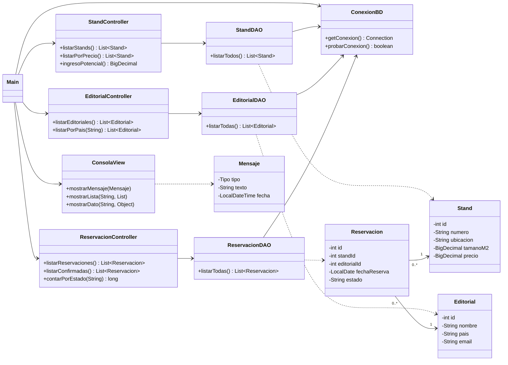
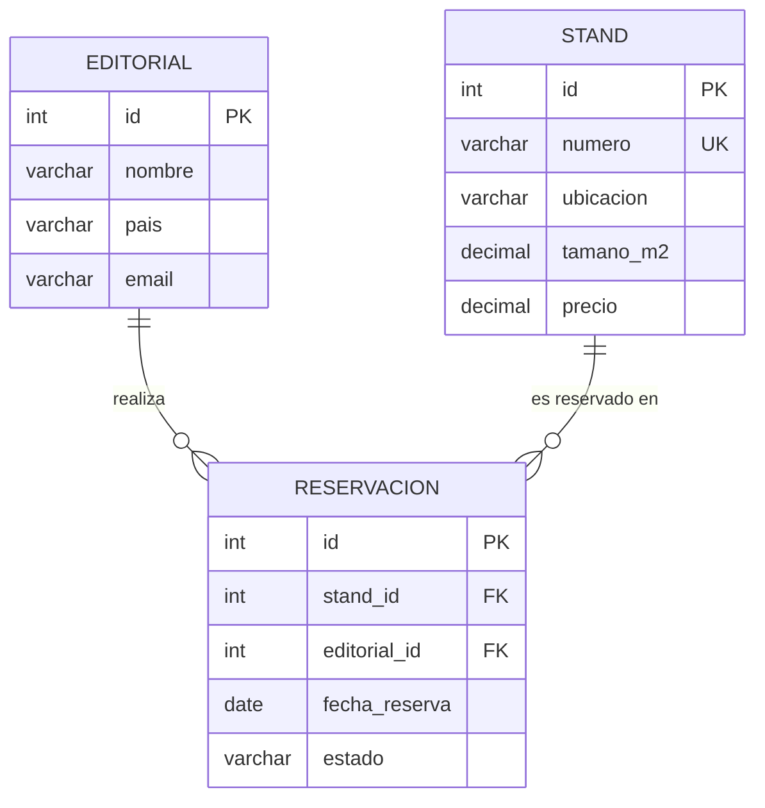

# PD4 – Feria del Libro: Stands, Editoriales y Reservaciones (MVC + JDBC)

Aplicación Java que lee de una base de datos MySQL las entidades **Stand**, **Editorial** y **Reservación**, usando el patrón **MVC** y una **capa de base de datos** con **JDBC**.

> 🎥 **Video explicativo:** https://alumnosuady-my.sharepoint.com/:v:/g/personal/a22204072_alumnos_uady_mx/IQCZ9SfpbSGmTK0eKKAhKlrZATf8hJqqy9ST3kykksEFxhQ?nav=eyJyZWZlcnJhbEluZm8iOnsicmVmZXJyYWxBcHAiOiJPbmVEcml2ZUZvckJ1c2luZXNzIiwicmVmZXJyYWxBcHBQbGF0Zm9ybSI6IldlYiIsInJlZmVycmFsTW9kZSI6InZpZXciLCJyZWZlcnJhbFZpZXciOiJNeUZpbGVzTGlua0NvcHkifX0&e=d5q7ru

## Qué se implementó

- **Modelo** (`model/`): todas las entidades de datos → `Stand`, `Editorial`, `Reservacion`, `Mensaje`.
- **Controladores** (`controller/`): toda la lógica de negocio.
  - `StandController`: lista stands, ordena por precio, calcula ingreso potencial.
  - `EditorialController`: lista editoriales y filtra por país.
  - `ReservacionController`: lista reservaciones, filtra confirmadas, cuenta por estado.
- **Capa de BD** (`db/`, un solo paquete): `ConexionBD` + `StandDAO`, `EditorialDAO`, `ReservacionDAO` (JDBC con `PreparedStatement` y `try-with-resources`, así cada consulta cierra su conexión sola).
- **Vista** (`view/`): `ConsolaView` solo imprime; no tiene lógica ni acceso a BD.
- **`Main`**: prueba la conexión a la BD y presenta las listas de Stands, Editoriales y Reservaciones.

## Estructura

```
stands-mvc/
├── docker-compose.yml        # MySQL 8.4 en Docker (carga schema.sql automáticamente)
├── pom.xml                   # Maven (Java 17 + mysql-connector-j)
├── sql/schema.sql            # Tablas + datos de ejemplo
└── src/main/java/com/pd4/standsapp/
    ├── Main.java
    ├── model/        Stand, Editorial, Reservacion, Mensaje
    ├── controller/   StandController, EditorialController, ReservacionController
    ├── db/           ConexionBD, StandDAO, EditorialDAO, ReservacionDAO
    └── view/         ConsolaView
```

## Cómo ejecutarlo

Requisitos: Java 17+, Maven y Docker.

```bash
# 1) Levantar la base de datos (crea la BD ferialibro con datos de ejemplo)
docker compose up -d

# 2) Compilar y ejecutar (espera ~20 s a que MySQL arranque la primera vez)
mvn compile exec:java
```

Variables opcionales para apuntar a otra BD (por ejemplo en la nube): `DB_URL`, `DB_USER`, `DB_PASSWORD`.
Valores por defecto: `jdbc:mysql://localhost:3306/ferialibro`, usuario `root`, contraseña `root1234`.

### Salida esperada 

```
[EXITO] Conexión a la BD exitosa: jdbc:mysql://localhost:3306/ferialibro...

=== STANDS (5) ===
  Stand{id=1, numero=A-01, ...}
=== EDITORIALES (4) ===
  Editorial{id=2, nombre=Fondo de Cultura Económica, ...}
=== RESERVACIONES (4) ===
  Reservacion{id=1, stand=A-01, editorial=Editorial Planeta, ...}
```

## Diagrama de clases



## Diagrama Entidad-Relación



> Si GitHub no renderiza los diagramas en tu visor, sí lo hace al abrir este README en el repositorio (soporta Mermaid de forma nativa).

## Flujo MVC + BD

```
Main → Controlador (lógica de negocio) → DAO (JDBC, paquete db) → MySQL
                 ↓
              Modelo (entidades)  →  Vista (ConsolaView) imprime
```

